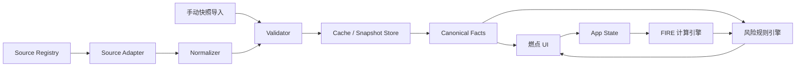
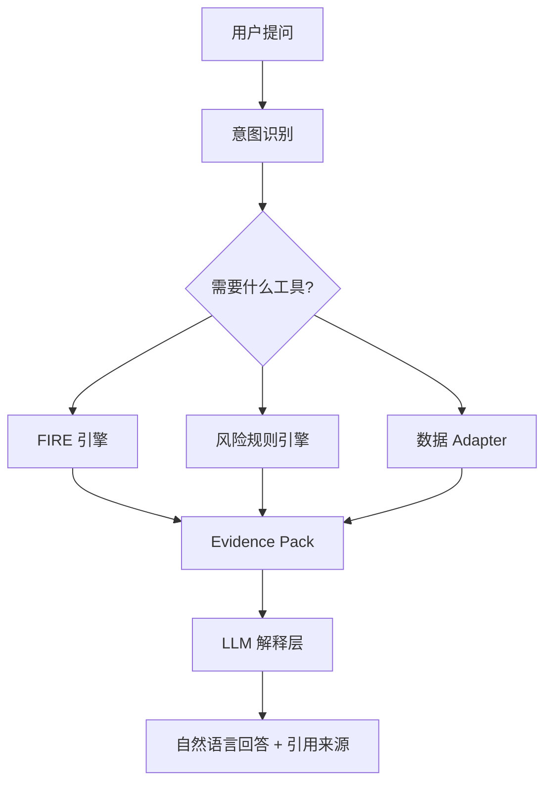
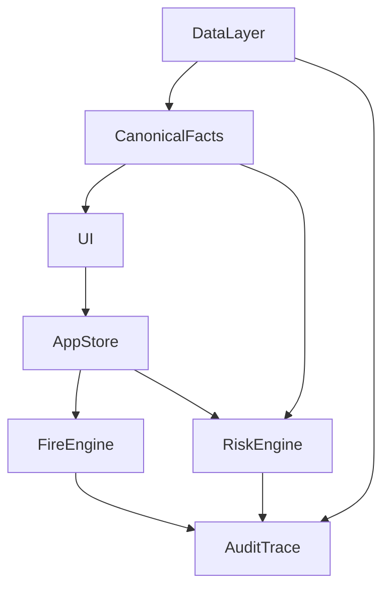

# 燃点 FIRE Planner 2.0 独立评估报告

> 评估日期：2026-11-17  
> 评估对象：现有静态 FIRE 测算台 + 拟议的「燃点 FIRE Planner 2.0 PRD」  
> Git 基线：`main @ 718a600`，回退标签 `baseline-2026-11-17`  
> 重要前提：本次检索未在工作区、近 7 天会话和 WorkBuddy 资料库中找到《燃点 FIRE Planner 2.0 PRD》原文。以下评估基于你给出的 10 项要求、现有代码和当前产品形态。若能补充 PRD 原文，可再输出逐条差距矩阵。

---

## 1. 总体判断

现有产品是一个干净的静态单页应用，优点是计算在浏览器本地完成、部署简单、交互清楚。缺点是计算、状态、渲染、格式化都耦合在 `app.js` 中，尚无规则引擎、数据源治理和审计层。

2.0 的合理方向不是“把 AI 塞进去”，而是先做三件事：

1. **把 FIRE 计算抽成可测试的纯函数引擎**，保证任何数字都能复现。
2. **把外部数据做成带来源、时间、授权和缓存治理的 Adapter 层**，不直接让 UI 调散接口。
3. **把风险提示做成确定性规则引擎**，LLM 只做解释，不做计算裁判。

不建议在 MVP 阶段引入实时宏观数据、实时行情、复杂 Agent 或自主决策。先做“可复现的财务计算 + 可解释的风险检查 + 可追溯的数据快照”。

---

## 2. 现有功能与拟议 2.0 的差距

### 2.1 已具备能力

| 能力 | 现状 |
|---|---|
| 7 类支出调整 | 滑杆 + 数字输入，月度合计动态更新 |
| 年化收益率 / 通胀率 / 测算年限 | 支持滑杆和数字输入 |
| 两种 FIRE 模式 | 「细水长流」有限期限消耗本金；「金鹅永续」维持购买力 |
| 曲线起点切换 | 可按反推目标或用户输入本金测算 |
| 医疗专项储备 | 四档预设 + 自定义金额 |
| 补充储备测算 | 住家储蓄、副业被动收入、组合方式 |
| FIRE 后储备利息 | 医疗储备 + 10% 安全垫在 FIRE 后产生利息，抵扣支出 |
| 红利低波定投测算 | 定投年限、月定投金额、年化收益率、股息率可配置 |
| 明细导出 | CSV 导出当前假设和现金流 |
| 明暗主题 | 浏览器本地记忆 |
| 本地计算 | 无后端依赖，纯浏览器计算 |

### 2.2 主要差距

| 领域 | 当前状态 | 2.0 需要补齐 |
|---|---|---|
| 计算引擎 | `app.js` 内函数与 UI 耦合 | 抽离为纯 TS/JS 模块，带版本号和审计信息 |
| 风险防御中心 | 尚未存在 | 确定性规则引擎 + 风险卡片 + 证据链 |
| 数据源 | 无外部数据，全部用户输入 | Adapter 层、缓存、来源、更新时间、失效策略 |
| 结果复现 | 计算逻辑可读，但缺少测试和版本化 | 黄金测试、快照测试、输入/输出版本号 |
| 状态持久化 | 只有主题写入 localStorage | 方案快照、参数版本、可分享 JSON |
| LLM | 无 | MVP 不建议引入；后期只做解释层 |
| 安全与授权 | 无外部 API Key | 如接付费源，必须服务端代理，不能把 Key 放前端 |
| 文档与口径 | 页面有简要说明，但公式细节分散 | 计算口径文档 + 公式编号 + 数据字典 |

### 2.3 PRD 对齐缺口

由于 PRD 原文缺失，以下是必须向 PRD 或产品负责人确认的关键问题：

1. 风险防御中心是“规则检查器”还是“投顾建议器”？建议前者。
2. 宏观数据是否要求实时？建议 MVP 用官方快照，不做实时爬取。
3. 基金/指数数据是否允许使用非官方爬虫源？建议 MVP 只做参考，不作为合同级数据。
4. 用户方案是否需要保存、分享、导入导出？建议 MVP 支持本地 JSON。
5. LLM 是产品必需能力，还是增强能力？建议增强能力，且延后。
6. 风险等级是否需要统一评分？建议 MVP 不做总分，只做分项风险卡。

---

## 3. 风险防御中心的产品合理性

### 3.1 合理性

风险防御中心有价值，前提是它回答三类问题：

1. **假设是否合理**：收益率、通胀率、年限、支出增速是否偏离官方数据或常识区间。
2. **储备是否足够**：医疗储备、现金储备、安全垫、储备积累时长是否覆盖风险事件。
3. **结构是否脆弱**：收入来源是否过度依赖副业或股息，是否存在序列风险、集中风险。

它不应承担的任务：

- 预测市场崩盘。
- 给出买卖建议。
- 输出一个无法解释的“风险分数”。
- 用 LLM 自由推理替代财务公式。

### 3.2 建议产品形态

MVP 阶段建议做成“风险检查卡”，而不是“风险仪表盘”。

每张卡固定包含：

| 字段 | 说明 |
|---|---|
| 风险 ID | 可追踪、可测试 |
| 等级 | 提示 / 注意 / 风险 / 阻断 |
| 标题 | 用户能看懂 |
| 判断依据 | 公式、阈值、数据来源 |
| 当前值 | 用户输入或外部数据 |
| 参考值 | 官方数据或规则阈值 |
| 建议 | 明确动作，例如“调低收益率假设”或“提高医疗储备” |
| 数据更新时间 | 若使用外部数据必须展示 |
| 版本 | 规则版本，便于回溯 |

### 3.3 MVP 风险规则建议

| 规则 | 类型 | 数据依赖 | 说明 |
|---|---|---|---|
| 收益率过高 | 假设检查 | 无 / 无风险利率快照 | 如长期股票+债券组合设定 12%+，应提示过乐观 |
| 通胀假设偏离 | 假设检查 | 官方 CPI 快照 | 用户通胀假设显著偏离 CPI 时提示 |
| 储备月数不足 | 储备检查 | 无 | 医疗 + 现金储备 / 月支出 低于阈值 |
| 医疗储备档位不足 | 储备检查 | 无 | 低于用户所选风险档位下限 |
| FIRE 后储备利息依赖度过高 | 结构检查 | 无 | 储备利息 / 年支出 过高时提示结构脆弱 |
| 副业收入依赖 | 结构检查 | 无 | 储备积累过度依赖副业 |
| 股息依赖 | 结构检查 | 基金分红快照 | 股息率假设高于历史区间 |
| 期限过短 | 模型检查 | 无 | 50 岁 FIRE 但只测算 20 年，可能低估长寿风险 |
| 数据过期 | 数据治理 | Adapter | 外部快照超过 staleAfter，提示不可作为决策依据 |

### 3.4 不建议 MVP 做的事

- 不做“市场风险预测”。
- 不做“健康/长寿风险精算模型”。
- 不做“保险产品推荐”。
- 不做实时舆情/新闻风险。
- 不做 LLM 自主调整用户参数。

---

## 4. 数据源接入可行性

> 以下信息基于 2026-11-17 公网检索，接入前仍需阅读最新官方条款。

### 4.1 数据源清单

| 数据 | 推荐来源 | 免费/付费 | API Key | 授权与限制 | 2.0 建议 |
|---|---|---|---|---|---|
| GDP / CPI / PPI / PMI | 国家统计局 | 免费网页与数据库；未发现公开开发者 API | 无 | 官方数据可查询下载，但未见明确开放 API 与频次声明；程序化访问存在反爬和稳定性风险 | MVP 用手动快照或受控代理，不做高频抓取 |
| CPI / PPI / PMI 聚合 | AkShare | 免费，MIT 开源库 | 大多无需 Key | 库本身 MIT，但底层数据来自公开网站；声明仅供学术研究/参考；接口可能变动 | 可作为数据采集工具，不承诺生产 SLA |
| LPR / 货币政策 / 社融 | 中国人民银行 / 全国银行间同业拆借中心 | 免费 | 无 | 官方网页发布，API 治理不如商业 API 清晰 | MVP 手动快照 |
| 国债收益率曲线 | 中国债券信息网 | 自 2026-01-19 起向公众免费提供国债及政策性金融债收益率曲线查询下载 | 无 | 免费公开下载，但仍应遵守网站/产品条款；商用或再分发需另行确认 | 适合做无风险利率参考，MVP 手动快照 |
| 国债收益率曲线聚合 | AkShare | 免费 | 无 | 数据源来自公开网站；接口可能限制跨度或变动 | 作为辅助，不作唯一事实源 |
| 国债收益率曲线 | Tushare Pro | 部分接口需单独权限 | 需要 Token | 单独权限接口，不适合作为第一优先级 | 延后 |
| A 股行情 / 财务 | Tushare Pro | 免费额度有限，付费阶梯 | 需要 Token | 2000 积分约 ¥200/年：200 次/分钟，10 万次/天/API；5000 积分约 ¥500/年：500 次/分钟，常规数据无总量上限；特色和部分数据另需权限 | 若需要 A 股财务/基本面，作为付费候选 |
| 公募基金净值 / 分红 | 天天基金 / 东方财富，经 AkShare | 免费 | 无 | 无官方开放 API；存在延迟、页面变更和访问限制；适合参考，不适合承诺生产 SLA | MVP 可用于基金参考数据，但必须标注来源 |
| 指数股息率 / 编制规则 | 中证指数官网 | 免费/商业产品并存 | 视产品而定 | 指数资料可查，商用再分发需确认 | 手动快照优先 |
| Wind / Choice / iFind | 商业数据商 | 付费 | 需要 | 授权严格，通常禁止未授权再分发 | 延后，除非用户已有账号 |
| 新闻 / 舆情 | 各新闻或 Tushare 附加源 | 付费或受限 | 需要 | 授权和合规风险高 | 延后 |

### 4.2 关键原则

1. **官方优先**：宏观数据必须能追溯到国家统计局、央行、财政部、中国债券信息网等原始来源。
2. **来源可替代**：同一指标至少设计一个主源和一个备源。
3. **不得裸用 Key**：付费 API Key 必须放在服务端代理或受控后端，不能进入前端 bundle。
4. **快照优先于实时**：FIRE 是长期规划，不需要秒级数据；MVP 用日级/月级快照即可。
5. **数据必须有元数据**：来源、原始 URL、发布时间、采集时间、频率、单位、修订号、失效时间。
6. **爬虫源不承担 SLA**：AkShare / 天天基金类数据适合参考，不能作为合同级数据。

---

## 5. 统一数据源 Adapter 架构

### 5.1 分层设计



### 5.2 Adapter 接口

```ts
interface DataSourceAdapter {
  id: string;                       // 例如 nbs.cpi.yoy
  kind: "macro" | "market" | "fund" | "rate" | "manual";
  name: string;
  sourceUrl: string;
  license: string;
  requiresProxy: boolean;
  auth: "none" | "serverKey" | "userToken";
  schedule?: string;                // 例如 monthly、daily
  staleAfterHours: number;
  fetch(params: FetchParams): Promise<RawResponse>;
  normalize(raw: RawResponse): CanonicalSeries;
  validate(series: CanonicalSeries): ValidationResult;
}
```

### 5.3 Canonical Data Point

每个数据点至少包含：

```ts
interface DataPoint {
  metricId: string;                 // macro.cn.cpi.yoy
  sourceId: string;                 // nbs.manual
  sourceUrl: string;
  date: string;                     // 数据所属日期
  publishedAt?: string;             // 官方发布时间
  fetchedAt: string;                // 本系统采集时间
  value: number;
  unit: string;                     // %、指数点、CNY、倍数
  currency?: string;
  frequency: "daily" | "weekly" | "monthly" | "quarterly" | "yearly";
  revision: number;
  license: string;
  staleAfter: string;               // ISO datetime
  qualityFlags: string[];           // provisional、estimated、missing、stale
}
```

### 5.4 缓存与失效

| 层 | 建议 |
|---|---|
| 浏览器 | IndexedDB 存快照；localStorage 只存用户偏好，不存大表 |
| 服务端 | SQLite / KV 缓存原始响应和规范化结果 |
| 更新策略 | 按指标 TTL 更新；宏观数据月级，收益率日级，基金净值日级 |
| 失效 | 超过 staleAfter 后 UI 明确提示“数据已过期”，不得静默使用 |
| 版本 | 保留 revision 和 fetchedAt，避免宏观修订导致结果不可复现 |
| 限流 | Adapter 内部串行 + 退避重试；避免一次页面刷新触发大量请求 |

### 5.5 MVP 数据接入方式

建议 MVP 不做自动爬取，而是：

1. 提供一个 **手动快照导入** 能力：用户或维护者上传 JSON/CSV。
2. 每条快照强制填写来源、发布时间、采集时间、单位。
3. Adapter 只负责把快照规范化为 Canonical Facts。
4. UI 显示“来源 + 更新时间”，满足可追溯要求。

这比一上来就爬国家统计局或天天基金更稳，也符合“外部数据必须有来源和更新时间”的要求。

---

## 6. 风险规则引擎

### 6.1 设计原则

- **确定性**：同一输入、同一规则版本、同一数据版本，必须输出同一结果。
- **可解释**：每条结果都要能展示判断链。
- **可测试**：规则要能用 fixture 测试。
- **不使用 LLM 判断**：LLM 只能总结规则输出。

### 6.2 规则结构

```ts
interface RiskRule {
  id: string;
  version: string;
  severity: "info" | "notice" | "warning" | "critical" | "blocking";
  title: string;
  description: string;
  when: RuleCondition;
  then: RiskOutcome;
  dataRefs: string[];
}
```

### 6.3 推荐规则样例

```json
{
  "id": "inflation_assumption_deviation",
  "version": "2026.11.1",
  "severity": "notice",
  "title": "通胀假设与官方 CPI 偏离较大",
  "when": {
    "all": [
      { "fact": "assumption.inflationRate", "op": "exists" },
      { "fact": "macro.cn.cpi.yoy.latest", "op": "exists" },
      { "fact": "assumption.inflationRate", "op": "deviatesBeyond", "target": "macro.cn.cpi.yoy.latest", "pct": 1.5 }
    ]
  },
  "then": {
    "message": "你的通胀假设高于/低于最近官方 CPI 同比。长期 FIRE 规划可以保留个人化假设，但应说明差异原因。",
    "recommendation": "确认是否包含居住、医疗、教育等个性化通胀因素。"
  },
  "dataRefs": ["macro.cn.cpi.yoy.latest"]
}
```

### 6.4 输出结构

```ts
interface RiskAssessment {
  evaluatedAt: string;
  ruleEngineVersion: string;
  assumptionsVersion: string;
  dataVersion: string;
  results: RiskResult[];
}

interface RiskResult {
  ruleId: string;
  ruleVersion: string;
  severity: string;
  triggered: boolean;
  title: string;
  message: string;
  evidence: {
    label: string;
    value: string | number;
    sourceId?: string;
    sourceUrl?: string;
    asOf?: string;
    fetchedAt?: string;
  }[];
}
```

---

## 7. FIRE 计算引擎

### 7.1 目标

把现有 `app.js` 中的计算抽成独立、可测试、无 DOM 的模块。

### 7.2 模块拆分

| 模块 | 职责 |
|---|---|
| `validateAssumptions()` | 校验收益率、通胀、年限、储备、定投等输入 |
| `buildExpenseModel()` | 汇总支出、按通胀生成年度支出曲线 |
| `buildReservePlan()` | 医疗、现金、安全垫、积累时长、FIRE 后利息 |
| `calculateRequiredCapital()` | 反推投资本金，支持有限期限与永续口径 |
| `simulateCashflow()` | 年度现金流模拟 |
| `calculateDcaDividendPlan()` | 红利低波定投与股息提取 |
| `runSensitivity()` | 收益率 / 通胀 / 年限敏感性 |
| `createAuditTrace()` | 记录公式、输入、版本、时间 |

### 7.3 核心输出

```ts
interface FireResult {
  engineVersion: string;
  assumptions: FireAssumptions;
  expenses: ExpenseSummary;
  reservePlan: ReservePlan;
  requiredCapital: RequiredCapital;
  cashflow: CashflowPoint[];
  dcaPlan: DcaDividendPlan;
  audit: AuditTrace;
}
```

### 7.4 可复现性要求

1. 每次计算输出 `engineVersion`、`assumptionsHash`、`dataVersion`。
2. 黄金测试保存输入 + 输出快照。
3. 公式变更必须提升引擎版本。
4. UI 展示“计算口径版本”，避免用户不知道结果来自哪套公式。
5. 导出的 CSV/JSON 必须包含完整假设和版本。

---

## 8. 现有计算模型口径问题

### 8.1 已确认的模型

以细水长流为例：

- 毛支出现值：  
  `G = requiredPrincipal(annualExpense, r, i, N)`

- 10% 安全垫：  
  `P = 0.1 × (R + M + C)`

- FIRE 后利息基数：  
  `B = M + P = 1.1M + 0.1R + 0.1C`

- 年利息：  
  `I = rr × B`

- 有限期限下，反推本金：  
  `R = [G - AF × rr × (1.1M + 0.1C)] / [1 + 0.1 × AF × rr]`  
  其中 `AF = Σ 1/(1+r)^t`

当前实现把这个固定点方程解析化了，数学上是可复现的。

### 8.2 口径判断：没有明显重复计入

储备利息来自储备池，不来自投资本金；投资本金反推时扣除储备利息的现值。二者不构成资产重复计入。

但需要注意：**储备利息作为收入流抵扣支出**，这已经改变了反推口径。页面文案必须清楚说明，否则用户会误以为只是“储备金额变了”。

### 8.3 需要修正或确认的问题

| 编号 | 问题 | 风险 | 建议 |
|---|---|---|---|
| 1 | 储备利息按固定名义金额处理，不随通胀增长 | 长期会低估/高估储备利息的实际购买力 | 在 UI 明确“名义利息”；后期可提供“储备本金随通胀调整”开关 |
| 2 | 36 个月现金储备未纳入 FIRE 后利息基数 | 如果现金储备也吃息，会低估利息 | 确认口径：医疗+安全垫吃息，还是全部储备吃息 |
| 3 | 医疗储备默认从 ¥50,000 改为 ¥150,000，但预期本金仍默认 ¥1,885,510 | 用户可能混淆旧目标与新目标 | 保留用户输入没问题，但应显示“口径已更新”提示 |
| 4 | 反推本金已扣除储备利息，但“覆盖 N 年支出”文案仍像毛支出 | 用户可能误读 | 改为“覆盖 N 年净支出” |
| 5 | “保守目标 40 倍年支出”未考虑 FIRE 后储备利息 | 与反推口径不再完全可比 | 增加开关：是否对保守目标也计入储备利息 |
| 6 | 图表图例仍是“当年支出”，实际是扣除储备利息后的净支出 | 口径不一致 | 图例改为“当年净支出” |
| 7 | CSV 中“当年支出”也是净支出 | 导出数据可能被误用 | 增加列：毛支出、储备利息抵扣、净支出 |
| 8 | 图表初始本金横线仍使用 `state.principal`，即使曲线起点是反推目标 | 用户可能误读目标曲线 | 图表起点为反推目标时，横线应显示反推本金 |
| 9 | 红利低波模块的“年化收益率”未明确是价格收益还是含分红总收益 | 股息测算可能重复或遗漏 | 明确“含分红再投资的总收益”，或拆成价格收益 + 股息率 |
| 10 | 储备利息超过毛支出时，超出部分未滚存 | 高储备场景下略保守 | MVP 可接受；后期增加“利息滚存策略” |
| 11 | 未计税费、申赎费、基金管理费、医保缴费 | 长期规划会偏乐观 | 明确免责；后续作为可选模块 |
| 12 | 未考虑收益波动与序列风险 | 确定性测算无法反映坏序列 | 2.0 后期做敏感性或蒙特卡洛 |

### 8.4 与收益率 / 通胀 / 储备相关的口径建议

1. **投资收益率**：继续作为主投资组合假设，不与储备利率混用。
2. **储备利率**：只作用于 FIRE 后的医疗储备 + 安全垫，不作用于 36 个月现金储备，除非用户另行确认。
3. **通胀率**：继续作用于毛支出；储备利息是否通胀调整需要单独开关。
4. **红利低波收益率**：建议明确为“含分红再投资的总收益”。
5. **安全垫**：继续作为储备池的一部分，不参与主投资收益率。

---

## 9. LLM Provider、Tool Calling 与 Agent Workflow

### 9.1 是否需要 LLM

MVP 不需要。

LLM 能带来的价值是：

- 把确定性结果解释得更自然。
- 帮助用户理解风险卡。
- 引导用户补充参数。

LLM 不应承担：

- 财务计算。
- 判断数据真假。
- 修改规则阈值。
- 给投资建议。
- 自主执行 Agent 流程。

### 9.2 Provider 方案

| 方案 | 适用 | 优点 | 缺点 | 建议 |
|---|---|---|---|---|
| 不接 LLM | MVP | 零成本、零幻觉、完全本地 | 文案固定 | MVP 采用 |
| OpenAI 兼容 API | 后期 | 生态成熟，易于换模型 | 需要 Key、费用、隐私 | 需要时通过服务端代理 |
| 国产模型 API | 后期 | 中文表现好 | 同样需要 Key | 可作为可切换 Provider |
| 本地模型 | 特殊场景 | 隐私好 | 质量与部署成本问题 | 不建议默认方案 |

### 9.3 Tool Calling 设计

只允许 LLM 调用确定性工具：

| 工具 | 作用 |
|---|---|
| `get_fire_snapshot` | 获取当前 FIRE 输入/输出 |
| `get_risk_assessment` | 获取规则引擎结果 |
| `get_macro_fact` | 获取带来源的宏观数据 |
| `get_reserve_plan` | 获取储备计划 |
| `get_dca_plan` | 获取红利低波定投结果 |
| `explain_metric` | 解释某个指标公式 |

规则：

1. LLM 不能直接执行数学计算。
2. 工具返回结果必须带版本和时间。
3. LLM 输出必须引用工具结果或数据来源。
4. 用户敏感参数不上传，除非用户明确同意。
5. 所有 LLM 会话记录可关闭。

### 9.4 Agent Workflow

推荐“窄 Agent”，不是自主 Agent：



核心原则：

1. 数字来自 FIRE 引擎。
2. 风险来自规则引擎。
3. 数据来自 Adapter。
4. LLM 只组织语言。
5. 没有证据时，LLM 必须回答“无法判断”。

---

## 10. MVP 与延后范围

### 10.1 MVP 必须

| 能力 | 理由 |
|---|---|
| Git 基线与回退标签 | 已完成 |
| FIRE 计算引擎抽离 | 保证可复现、可测试 |
| 现有功能不回退 | 保留本地计算和交互 |
| 黄金测试 | 固定输入输出，防止公式回归 |
| 风险规则引擎 v0 | 用用户输入即可跑，不依赖外部数据 |
| 风险卡 UI | 与现有黑金设计语言一致 |
| 手动数据快照导入 | 满足来源和更新时间要求 |
| Canonical Data Point | 统一数据结构 |
| 方案快照导出 JSON | 便于复现和分享 |
| 计算口径文档 | 避免口径漂移 |

### 10.2 延后

| 能力 | 延后原因 |
|---|---|
| 实时宏观数据抓取 | 合规、稳定性、CORS、授权复杂 |
| 实时基金/股票行情 | 对 FIRE 长期规划价值有限 |
| LLM 解释层 | 不是刚需，且容易引入幻觉 |
| Agent 自主分析 | 控制力不足 |
| 蒙特卡洛模拟 | 有价值但应先稳定确定性模型 |
| 税费 / 医保缴费 / 长期护理 | 需要单独建模 |
| 多用户账户 | 产品复杂度大幅上升 |
| 云同步 | 涉及隐私和授权 |
| 组合优化 | 超出 FIRE Planner 边界 |

---

## 11. 推荐架构

### 11.1 技术选型

| 层 | 推荐 | 理由 |
|---|---|---|
| 前端 | 原生 HTML/CSS/JS 或 Vite + TypeScript | 保持轻量，避免为引入框架而引入框架 |
| 状态 | 小型 store 模块 | 现有应用状态简单 |
| 计算 | 纯 TypeScript / 纯 JS 模块 | 可在浏览器和 Node 测试环境复用 |
| 图表 | 继续手写 SVG 或轻量库 | 保持现有设计语言 |
| 测试 | Vitest 或 Node test runner | 适合纯函数 |
| 数据缓存 | IndexedDB | 浏览器本地、容量比 localStorage 大 |
| 后端 | 可选轻量 Node/Edge Function | 仅在需要代理 API Key 时引入 |
| 存储 | JSON 快照 / SQLite | 简单、可审计 |
| LLM | 延后 | MVP 不引入 |

### 11.2 目录建议

```text
fire-planner/
  index.html
  src/
    main.ts
    ui/
      components/
      views/
    core/
      fire/
        assumptions.ts
        expenses.ts
        reserves.ts
        required-capital.ts
        cashflow.ts
        dca-dividend.ts
        index.ts
      risk/
        rules.ts
        engine.ts
      data/
        types.ts
        registry.ts
        adapters/
          manual-snapshot.ts
        cache.ts
      shared/
        format.ts
        math.ts
    tests/
      fire.golden.test.ts
      risk.rules.test.ts
      data.adapter.test.ts
  docs/
    prd.md
    formulas.md
    data-sources.md
  data/
    snapshots/
```

### 11.3 依赖关系



关键约束：

1. `FireEngine` 不依赖 UI。
2. `RiskEngine` 不依赖 LLM。
3. `DataLayer` 不直接修改用户假设。
4. UI 可以在无外部数据时独立运行。
5. 外部数据只作为“参考事实”，不自动覆盖用户假设。

---

## 12. 工作量估算

> 以下为单人开发的相对估算，不含完整产品验收和长周期数据治理。

| 阶段 | 内容 | 工作量 |
|---|---|---:|
| P0 | Git、测试框架、核心计算抽离、黄金测试 | 4–6 人日 |
| P1 | UI 状态管理重构，保持现有功能 | 4–6 人日 |
| P2 | 风险规则引擎 v0 与风险卡 UI | 5–8 人日 |
| P3 | 手动数据快照、Canonical Facts、来源展示 | 3–5 人日 |
| P4 | Adapter 骨架 + 1–2 个免费/快照源 | 5–8 人日 |
| P5 | 方案导出/导入、审计追踪、口径文档 | 3–4 人日 |
| MVP 小计 | — | **24–37 人日** |
| 可选 P6 | LLM 解释层 + Tool Calling | 6–10 人日 |
| 可选 P7 | 敏感性 / 蒙特卡洛 | 5–10 人日 |
| 可选 P8 | 更多数据源与缓存治理 | 8–15 人日 |

MVP 建议按 **3–5 周** 规划；如果加 LLM 和多数据源，完整 2.0 约 **6–9 周**。

---

## 13. 技术风险清单

| 风险 | 影响 | 缓解 |
|---|---|---|
| PRD 缺失或频繁变化 | 范围蔓延 | 先冻结 MVP，PRD 补齐后再扩大 |
| 外部数据合规风险 | 法律与授权问题 | 优先官方快照，商用再分发前确认条款 |
| 数据源不稳定 | 页面展示错误 | Cache + stale 提示 + 备源 |
| API Key 泄露 | 账单和数据安全 | 服务端代理，前端不落 Key |
| 宏观数据修订 | 结果不可复现 | 保留 revision 和 fetchedAt |
| LLM 幻觉 | 误导用户 | LLM 只解释，不计算；输出必须引用证据 |
| 模型过度精确导致误信 | 用户高估确定性 | 页面持续展示“确定性测算，非承诺” |
| 现有 Vanilla JS 膨胀 | 后期难维护 | 抽模块，控制 UI 直接操作 |
| 浏览器性能 | 大量模拟卡顿 | MVP 保持确定性计算，复杂模拟异步化 |
| 设计语言漂移 | 产品不统一 | 沿用黑金 Design Tokens、面板、徽标、脚注结构 |
| 口径混乱 | 数字不可解释 | 公式编号、口径文档、UI 明示“净支出/毛支出” |

---

## 14. 分阶段实施计划

### Phase 0：基线与保护网

目标：不改用户可见行为，先把地基打好。

1. 完成 Git 基线：已提交 `718a600`，标签 `baseline-2026-11-17`。
2. 增加测试框架。
3. 将当前公式抽成纯函数。
4. 建立黄金测试：
   - 默认细水长流。
   - 默认金鹅永续。
   - 收益率 = 通胀率。
   - 零储备利息。
   - 高医疗储备。
5. 输出 `docs/formulas.md`。

### Phase 1：风险防御中心 MVP

目标：不依赖外部数据，先跑起来。

1. 实现 6–8 条规则。
2. 风险卡 UI，使用现有黑金风格。
3. 每条规则显示依据、当前值、阈值、建议。
4. 规则版本号可见。

### Phase 2：数据快照与 Adapter 骨架

目标：外部数据可追溯，但不过度自动化。

1. 定义 Canonical Data Point。
2. 实现手动 JSON/CSV 快照导入。
3. 每条数据展示来源、发布时间、采集时间。
4. 增加 stale 提示。
5. 不自动抓取。

### Phase 3：可选免费源接入

目标：小范围引入稳定数据。

1. 优先接入国家统计局 CPI 快照或中国债券信息网收益率快照。
2. Adapter 内做 schema 校验、单位转换、异常值检查。
3. 不做高频请求。
4. 不做自动覆盖用户假设。

### Phase 4：方案快照与审计

目标：让结果可复现。

1. 支持导出 JSON。
2. JSON 包含假设、结果、引擎版本、规则版本、数据版本。
3. 支持导入重建结果。
4. UI 显示“计算版本”。

### Phase 5：可选 LLM 解释层

目标：只解释，不判断。

1. Provider 可切换，Key 服务端保存。
2. 只允许调用确定性工具。
3. 输出必须引用规则和来源。
4. 默认关闭，用户显式开启。

---

## 15. 最终建议

**推荐架构**：  
保持轻量前端 + 纯函数 FIRE 引擎 + 确定性风险规则引擎 + 带元数据治理的数据 Adapter。LLM 延后，仅作为解释层。

**MVP 范围**：  
先做“可复现计算 + 风险规则 v0 + 手动数据快照 + JSON 审计导出”，不接实时宏观数据，不引入 LLM，不做自主 Agent。

**最重要的三件事**：

1. 先补 PRD 和口径文档，再扩功能。
2. 所有公式进入测试，不靠页面肉眼验证。
3. 外部数据只作为证据，不自动改变用户假设。

**回退方式**：  
当前版本已提交：

- 分支：`main`
- 提交：`718a600`
- 标签：`baseline-2026-11-17`

后续如对 2.0 不满意，可直接：

```bash
git checkout baseline-2026-11-17
```

---

## 附：待你补充的信息

1. 《燃点 FIRE Planner 2.0 PRD》原文或链接。
2. 医疗储备 + 10% 安全垫之外，36 个月现金储备是否也应计息。
3. FIRE 后储备利息是“固定名义利息”，还是储备本金随通胀调整后利息也增长。
4. 红利低波模块中的“年化收益率”是否为含分红再投资的总收益。
5. 是否希望保留当前默认预期本金 ¥1,885,510，还是随医疗储备口径自动更新。
